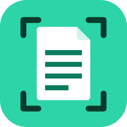
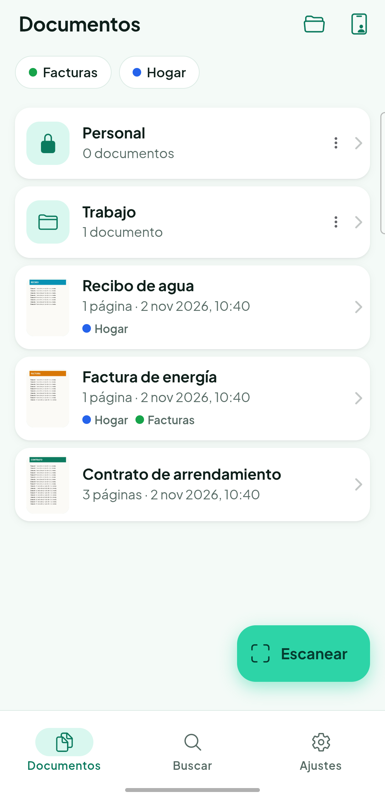
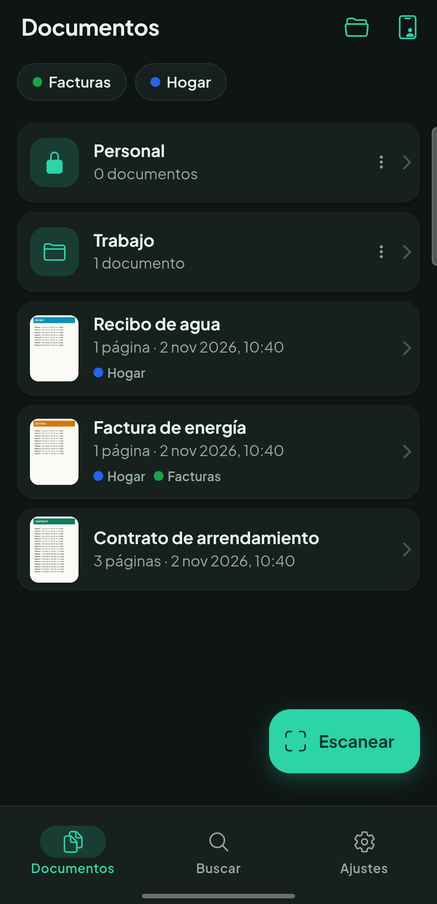
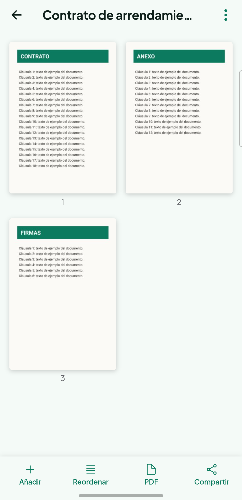
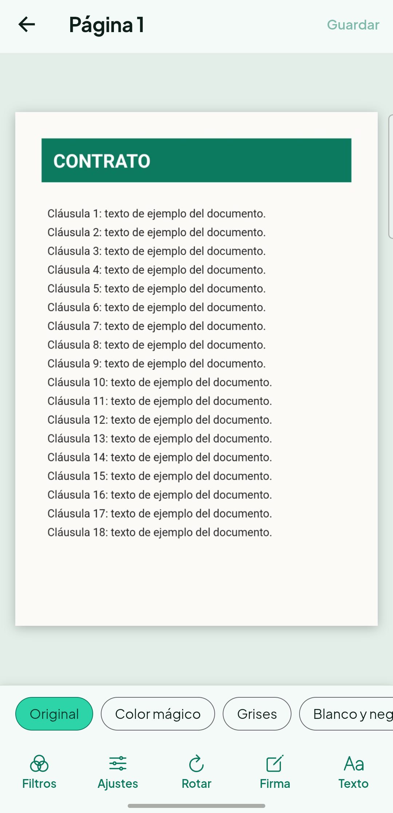
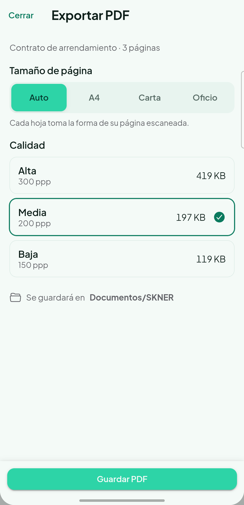
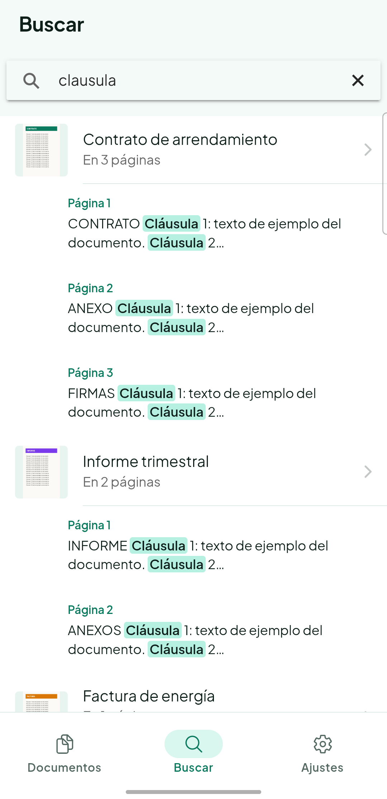

<p align="center">
  
</p>

<h1 align="center">SKNER</h1>

<p align="center">
  Escáner de documentos para Android.<br>
  <b>Sin anuncios, sin marcas de agua, sin suscripciones y sin internet.</b><br>
  Todo se procesa y se guarda solo en tu teléfono.
</p>

<p align="center">
  <a href="../../releases/latest"><b>⬇ Descargar el APK (última versión)</b></a>
</p>

---

## Qué hace

- **Escanea documentos** con detección de bordes, recorte y corrección de perspectiva (escáner de Google en el propio teléfono). Una página o lotes de hasta 50, también desde la galería.
- **Modo Documento de identidad:** las dos caras de la tarjeta en una sola hoja Carta o A4, a tamaño real.
- **Filtros:** Color mágico, Grises, Blanco y negro, Sin sombras, brillo, contraste y nitidez, y rotación.
- **Firma digital:** dibuja tu firma con el dedo (negra o azul) y estámpala, muévela y redimensiónala sobre cualquier página.
- **PDF:** tamaño Auto, A4, Carta u Oficio, y calidad Alta, Media o Baja con el **peso exacto** antes de guardar. Se guarda en *Documentos/SKNER*.
- **Texto (OCR) sin internet:** reconoce el texto de cada página; lo puedes corregir, copiar y compartir. Los PDF son **buscables** (puedes seleccionar y buscar el texto en cualquier lector).
- **Compartir:** PDF, imágenes o el texto, con WhatsApp, Gmail, Drive…
- **Organizar:**
  - Reordena las páginas arrastrándolas, une documentos, separa páginas en uno nuevo, renombra y elimina.
  - Carpetas, subcarpetas y etiquetas de colores.
- **Buscador:** encuentra documentos por título, etiqueta o el texto de sus páginas, sin tildes y con palabras incompletas.
- **Bóveda:** protege documentos o carpetas con tu **huella, tu rostro o el PIN** del teléfono.
- Diseño en verde menta, con tema claro y oscuro.

## Capturas

| Documentos | Tema oscuro | Visor |
|---|---|---|
|  |  |  |

| Editor y filtros | Exportar PDF | Buscador |
|---|---|---|
|  |  |  |

## Instalar

1. Descarga **`SKNER-x.y.z.apk`** desde [Releases](../../releases/latest) en tu teléfono Android.
2. Ábrelo. La primera vez, Android te pedirá permitir **"Instalar apps desconocidas"** para el navegador o la app de Archivos: acéptalo para esa app.
3. Toca **Instalar**.

**Requisitos:**
- **Android 7.0 o superior.**
- Teléfono con **Google Play Services**: el escáner de documentos es de Google. La primera vez que escanees, Play Services descarga su módulo (unos segundos, con conexión); después funciona sin internet.

**Actualizar:** descarga el APK nuevo e instálalo encima. Tus documentos se conservan.

## Privacidad

- La app **no tiene permiso de internet**: no puede enviar nada a ningún sitio.
- Tus documentos, firmas y textos se guardan **solo en el almacenamiento privado de la app**.
- La copia de seguridad automática de Android está **desactivada**: lo escaneado no sale del teléfono. Por eso, **si desinstalas la app, sus documentos se borran**. Exporta a PDF lo que quieras conservar antes.
- No hay cuentas, anuncios ni estadísticas.

## Verificar la descarga (opcional)

Cada versión publica el **SHA-256** del APK en su página de Releases. Todas las versiones van firmadas con el mismo certificado:

```
SHA-256 del certificado: d3:80:c5:68:29:6e:a6:2f:3b:5c:95:5f:39:30:5c:16:35:24:3d:9f:d2:ad:e7:ac:a2:11:67:e7:11:b3:df:5f
```

## Acerca de

Hecho por [@kenneth0710](https://github.com/kenneth0710).
Este repositorio solo contiene las descargas: el código fuente no es público.
